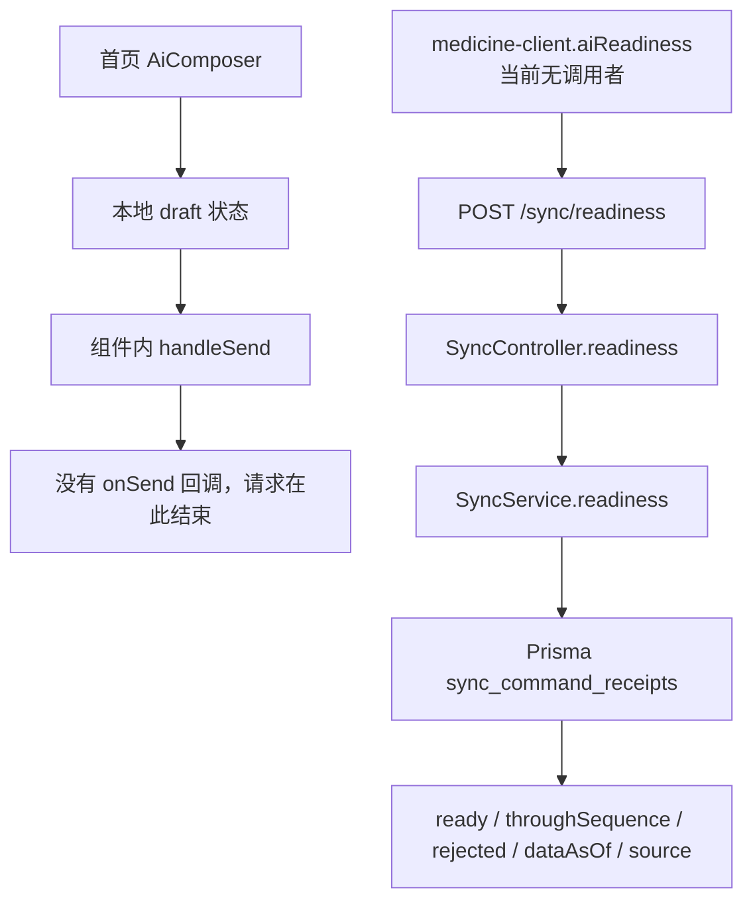
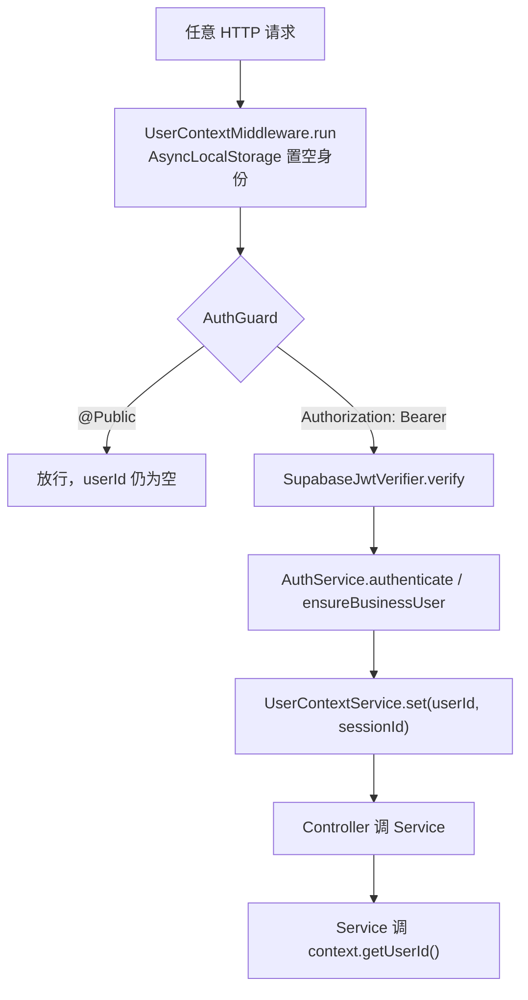

# 《千方记 AI Agent P1 开发前工程现状调查报告》

调查范围是当前工作区 `f:\medicine\medicine-api`。只读核对了源码、依赖、测试配置和 Git 状态，没有改文件、装依赖或跑迁移。兄弟仓库 `f:\medicine\medicine-app` 只用来回答「前端有没有把消息发给模型」；它不在本 Nest 仓库内。

结论先说清楚：本后端没有 AI 对话接口，没有 Ollama/LLM 客户端，没有 System Prompt、模型输出解析或 P1 领域/风险评估实现。P0 认证和用户上下文已经可用，P1 应作为新模块接上去，不要重做登录。

## 1. 项目技术栈与环境

这是前后端分离的两个仓库，不是 Monorepo。

- 后端根目录就是本仓库：`f:\medicine\medicine-api`。Nest 的 `sourceRoot` 是 `src`（`nest-cli.json`）。
- 前端在兄弟目录 `f:\medicine\medicine-app`（README 指向 `../medicine-app/doc/...`）。本仓库没有前端源码，也没有 workspace / packages 目录。

| 项 | 实际情况 |
| --- | --- |
| Node.js | `package.json` 要求 `>=22.13.0`；本机实际 `v24.18.0` |
| NestJS | 声明 `^12.0.1`；已安装 `@nestjs/common`、`@nestjs/core`、`@nestjs/platform-fastify` 均为 **12.1.3** |
| TypeScript | 声明 `^6.0.2`；已安装 **6.0.3** |
| 包管理器 | 锁文件是 **Yarn v1**（`yarn.lock`，本机 Yarn **1.22.22**）。没有 `package-lock.json`、`pnpm-lock.yaml`，也没有 `packageManager` 字段。README 示例写的是 npm（本机 npm **11.16.0**）。日常到底敲 npm 还是 yarn：**未确认** |
| HTTP 平台 | Fastify，不是 Express。`src/main.ts` 使用 `NestFastifyApplication`，body 上限 12 MB |
| 模块格式 | `"type": "module"`。`tsconfig.json` 为 `module` / `moduleResolution`: `nodenext`。源码 import 带 `.js` 后缀 |
| 数据库 | Prisma 7.10.1 + PostgreSQL（`@prisma/adapter-pg`、`pg`） |
| 认证 | `@supabase/supabase-js` 2.x、`jose` |

主要依赖：`@nestjs/common`、`@nestjs/core`、`@nestjs/config`、`@nestjs/platform-fastify`、`class-validator`、`class-transformer`、`@prisma/client`、`@prisma/adapter-pg`、`pg`、`@supabase/supabase-js`、`jose`、`dotenv`、`reflect-metadata`、`rxjs`、`standardwebhooks`。

TypeScript（`tsconfig.json`）：`target` ES2023，`strict: true`，`strictPropertyInitialization: false`，`experimentalDecorators` 与 `emitDecoratorMetadata` 开启，`outDir` 为 `dist`。**没有 `paths`，没有路径别名。** `vitest.config.ts` 虽然挂了 `vite-tsconfig-paths`，但 tsconfig 里无别名可解析。新文件应使用相对路径，例如 `../auth/user-context.service.js`。

Schema 工具：

- **class-validator 0.15.1、class-transformer 0.5.1 已安装，并且是全局 HTTP 校验方案。** `AppModule` 注册了 `ValidationPipe`（`whitelist`、`forbidNonWhitelisted`、`transform`）。
- **Zod 未安装**（`package.json`、`yarn.lock`、`node_modules` 都没有）。
- **Ajv 8.20.0 在 `node_modules` 里，但是 `@angular-devkit/core` 的传递依赖。** `src` 没有任何 `ajv` import，不能当作业务 Schema 库。

测试：**不使用 Jest。** Jest 未安装。测试运行器是 **Vitest 4.1.12**。

```json
"test": "vitest run",
"test:watch": "vitest",
"test:cov": "vitest run --coverage",
"test:e2e": "vitest run --config ./vitest.config.e2e.ts"
```

Git：当前分支 **`aiagent`**，最近提交 `f05bd3b`（说明是「配置服务器」）。`git status` 没有显示上游跟踪分支。已跟踪文件没有修改。唯一未提交内容是未跟踪文件 `scripts/seed-local-demo.ts`，与 AI/P1 无关。

## 2. 后端目录结构

`src` 顶层只有这些目录和入口：

```text
src/
  main.ts
  app.module.ts
  health.controller.ts
  common/filters/          http-exception.filter.ts、prisma-exception.filter.ts
  common/validation/       validation-exception.factory.ts
  config/                  env.validation.ts、sms-hook.config.ts
  database/prisma/         prisma.module.ts、prisma.service.ts
  database/                init.sql、comment.sql
  generated/prisma/        Prisma Client 生成物
  modules/
    auth/
    medicines/
    visits/
    reminders/
    sync/
    user-dictionaries/
    sms-hook/
```

`AppModule` 只导入：`ConfigModule`、`PrismaModule`、`AuthModule`、`SmsHookModule`、`MedicinesModule`、`VisitsModule`、`RemindersModule`、`SyncModule`、`UserDictionariesModule`。

**`src/ai` 不存在。** 全仓库没有这些文件：

- AI Controller / Module / Service / DTO
- Prompt、Parser、Interface、模型 Schema
- 名为 P0、P1、P2、P3、P4 的实现文件

和「AI」字样有关、但不是领域识别的现有文件：

| 路径 | 实际职责 |
| --- | --- |
| `src/modules/sync/sync.dto.ts` 的 `AiReadinessDto` | 同步水位请求体 |
| `src/modules/sync/sync.controller.ts` 的 `readiness()` | `POST /sync/readiness` |
| `src/modules/sync/sync.service.ts` 的 `readiness()` | 查 `sync_command_receipts`，判断设备操作是否已被云端接受 |

`prisma/schema.prisma` 的模型是用户、字典、药箱、就诊、提醒、血压、同步回执、账号删除。没有会话、消息、领域或风险评估表。

设计文档《千方记 AI Agent P1 领域识别与医疗风险评估设计 V1.0》不在本仓库。`f:\medicine` 下的 Markdown 也没有「领域识别 / 医疗风险 / p1-parser」匹配。文档本身的落地状态：**未确认**（本次只看到代码里没有对应实现）。

## 3. 当前 AI 请求执行链路

当前没有「用户消息进入模型再返回前端」的运行路径。

兄弟仓库首页 `medicine-app/src/screens/home/index.tsx` 渲染了 `AiComposer`，只绑定了本地 `draft`。没有传入 `onSend`。全 `medicine-app/src` 没有 `onSend=` 的调用点。输入框发送后只清空本地文本，不发 HTTP。

唯一带 AI 名字的网络方法是 `medicine-app/src/data/medicine-client.ts` 的 `aiReadiness()`，请求 `POST /sync/readiness`。该方法在 `src` 内没有其他调用者。它检查同步水位，不发送用户句子，也不调用模型。



这条链路的方法：

1. 前端：`MedicineClient.aiReadiness()`，`medicine-app/src/data/medicine-client.ts`
2. 路由：`SyncController.readiness()`，`POST /sync/readiness`
3. 服务：`SyncService.readiness(deviceId, throughSequence, resolvedOpIds)`
4. 身份：全局 `AuthGuard` 写入 `UserContextService`，服务里用 `this.context.getUserId()`
5. 返回字段：`ready`、`throughSequence`、`rejected`、`dataAsOf`、`source: 'database'`

因此第 3 节的 8 个问题，按代码事实是：

1. 前端聊天文本没有发往任何 API。
2. 没有对应的 AI Controller。`SyncController` 只处理同步。
3. 没有 AI Service。
4. 用户消息不会到达模型。
5. 没有模型返回结果可解析。
6. 没有领域识别、医疗风险评估或意图识别。
7. 没有模型输出的运行时 Schema 校验。HTTP 入参校验只覆盖现有 DTO。
8. 没有 AI 响应协议。现有接口由各 Service 直接返回业务对象；异常统一为 `{ statusCode, message, code? }`。

已有 HTTP 路由（均无模型调用）：

- `GET /health`（公开）
- `GET|PATCH /users/me`
- 账号删除相关路由；其中状态查询、取消、删除状态为 `@Public()`
- `POST /hooks/supabase/send-sms`（公开）
- `/medicines`、`/visits`、`/reminders`、`/blood-pressure-records`
- `/user-dictionaries`
- `/sync/snapshot|commands|readiness|attachments`

`main.ts` 没有 `setGlobalPrefix`。

## 4. LLM / Ollama 实现

| 问题 | 结论 |
| --- | --- |
| 模型供应方 | 不存在。无 Ollama、OpenAI 或其他 LLM SDK |
| 客户端文件 | 不存在 |
| 模型名与配置来源 | 不存在。`env.validation.ts` 只校验数据库、Supabase、端口、Host、短信。`.env`、`.env.example` 及两份 database env 示例的键名中没有 `OLLAMA`、`OPENAI`、`ANTHROPIC`、`LLM_`、`AI_`、`MODEL` |
| 请求参数 | 不存在 |
| System Prompt | 不存在 |
| JSON / Structured Output | 不存在 |
| 统一 LLM Interface | 不存在 |
| 超时、重试、异常 | 没有模型调用上的实现。超时只出现在 Supabase JWKS/Auth（5 秒）、账号删除和管理 API（8–30 秒）、同步事务（30 秒） |
| 原始输出格式 | 不存在 |
| JSON 解析失败降级 | 不存在模型降级。同步命令有自己的 `JSON.parse` 失败处理，见下一节 |

项目里已经使用全局 `fetch` 的地方是认证，不是模型。`SupabaseIdentityService` 给 `fetch` 加了 `AbortSignal.timeout(5000)`。这只能说明「以后用 `fetch` 调 Ollama 不需要先引入 HTTP 库」，不能当成 LLM 客户端。

## 5. Prompt / Parser 实现

不存在 System Prompt、User Prompt 构建、AI Parser、模型结果类型或模型结果校验。

最接近「解析 + 校验」的是同步命令，职责是离线操作回放，不能当作 P1 Parser：

```ts
// src/modules/sync/sync.service.ts
async function checked<T extends object>(
  type: new () => T,
  input: unknown,
): Promise<T> {
  const value = plainToInstance(type, input);
  const errors = await validate(value, {
    whitelist: true,
    forbidNonWhitelisted: true,
    forbidUnknownValues: true,
  });
  if (errors.length)
    throw new BadRequestException('操作内容校验失败，请核对原记录');
  return value;
}
```

`SyncService.apply()` 对 `depends_on` 和 `payload` 做 `JSON.parse`。解析失败抛 `BadRequestException('操作依赖格式无效')` 或 `'操作内容格式无效'`。没有「解析失败后改走安全默认领域」的降级。`base_op_id` 分支里另有一次未包 try 的 `JSON.parse(command.payload)`（约第 318 行），那是同步版本解析，与 P1 无关。

可复用的只有这些通用能力：

- 全局 `ValidationPipe` + `class-validator`，适合校验 HTTP 入参。
- `plainToInstance` + `validate` 这个函数形态，适合以后校验一块普通对象。它现在是 `sync.service.ts` 的模块私有函数，P1 不能直接 import。
- `createValidationException` 把校验错误收成一条中文 `message`。字段标签表是药品、就诊、提醒字段，没有领域/风险字段。

接口冲突：现有代码里没有意图识别接口，所以不存在「旧意图接口签名和新 P1 类型对不上」。命名上要注意 `AiReadinessDto` 已被同步占用，P1 不要复用这个名字或 `/sync/readiness`。

## 6. P0 身份及上下文

P0 已经接在全局请求链上，P1 可以直接用，不必再设计一套登录。



身份来源：

- 客户端带 `Authorization: Bearer <token>`。
- `SupabaseJwtVerifier.verify()` 用项目 JWKS 验 ES256，核对 issuer、audience、`sub`、`session_id`、角色、非匿名，以及 `password` 或 `otp`。
- `userId` 是 JWT 的 `sub`（UUID），再由 `SupabaseIdentityService.getVerifiedUser()` 向 Supabase 核对手机号。
- 业务库 `users.id` 与该 UUID 相同。首次访问会在事务里创建 `users` 和默认字典。
- `AuthGuard` 把 `{ userId, sessionId }` 写入 `UserContextService`。业务代码只从这里取用户，不接受 body 里的 `userId` 作为授权依据。

```ts
// src/modules/auth/user-context.service.ts
set(userId: string, sessionId: string): void {
  const identity = this.storage.getStore();
  if (!identity) throw new UnauthorizedException('请求身份不可用');
  identity.userId = userId;
  identity.sessionId = sessionId;
}

getUserId(): string {
  const userId = this.storage.getStore()?.userId;
  if (!userId) throw new UnauthorizedException('请先登录');
  return userId;
}
```

`AuthModule` 是 `@Global()`，并 `exports: [UserContextService]`，同时 `APP_GUARD` 使用 `AuthGuard`。新模块只要被 `AppModule` 导入，就可以在构造函数注入 `UserContextService`，不必再 import `AuthModule`。`PrismaModule`、`ConfigModule` 同样是全局的。

不存在 `AgentContext`。现有上下文只有 `userId` 和 `sessionId`，没有消息历史、对话 ID 或设备 ID。设备 ID 只出现在同步 DTO 里，由客户端随同步请求提交，并和 `userId` 一起查回执。

AI 请求鉴权：没有 AI 路由。新 Controller 只要不加 `@Public()`，就会自动走同一套 Guard。

安全日志与请求 ID：没有全局 request id，也没有 AI 审计日志。`Logger` 只用在短信 Hook、账号删除和未映射的 Prisma 错误。错误响应格式是 `{ statusCode, message, code? }`。Prisma 已知错误走 `PrismaExceptionFilter`，成功响应没有统一信封。

用户消息和历史如何传入：**当前没有这条数据。** 数据库也没有消息表。P1 若要读历史，需要新的请求字段或新存储；这不是现成上下文。

## 7. P1 各组件实现条件

下面 7 个文件在仓库中都不存在，也没有同名类。没有命名冲突。按现有模块习惯，应放在：

`src/modules/ai/`

并新增 `ai.module.ts`，在 `src/app.module.ts` 的 `imports` 里注册。文件内部 import 必须带 `.js`。

| 设计文件 | 是否已存在 | 可复用的邻近能力 | 注册与依赖 |
| --- | --- | --- | --- |
| `p1.schema.ts` | 否 | 领域枚举、风险枚举都没有。可用 class-validator 类，或新增 Zod。不要用传递依赖 Ajv | 纯类型/Schema，可不注册为 Provider |
| `p1-domain.prompt.ts` | 否 | 无 Prompt 模板 | 可导出常量，不必是 Provider |
| `p1-parser.service.ts` | 否 | 只有同步命令的 `JSON.parse` + `checked()`。不能 import 那个私有函数 | 注册为 Provider。它若调用模型，模型客户端目前不存在，需要另增 |
| `p1-validator.service.ts` | 否 | 可仿 `checked()`：`plainToInstance` + `validate` | 注册为 Provider。只依赖 class-validator / class-transformer 时不必加包 |
| `p1-safety-guard.service.ts` | 否 | 无医疗安全门闩。账号状态检查 `assertActive` 在 `auth.service.ts`，只管账号是否 active/deleting | 注册为 Provider。只做领域/风险判定时不必依赖药箱模块 |
| `p1-router.service.ts` | 否 | 无 Agent 路由。Nest 路由是 HTTP Controller | 注册为 Provider。P2/P3 代码不存在，现在没有后续流程可调用 |
| `p1.service.ts` | 否 | 无 AI Service。编排入口需要新建 | 注册为 Provider，注入 parser、validator、guard、router，以及现成的 `UserContextService` |

和现有 API 的关系：

- 现有 Controller 都不接收聊天文本，也不调用模型。只新增这 7 个文件并注册 Module，**不会改变**现有 URL 和返回体。
- 一旦新增例如聊天用的 Controller 并在其中调用 `p1.service`，那是新协议，不会自动改 `/medicines`、`/visits` 等。
- `POST /sync/readiness` 必须保持同步语义。P1 不要挂到这个路由上。
- 紧急风险要阻断 P2/P3：仓库里没有 P2/P3。阻断逻辑只能写在将来唯一的编排入口里；现在没有可被绕过的旧模型入口。

`p1-parser` 若要访问用户数据，应使用 `UserContextService.getUserId()`，不要从模型输出或请求体信任 `userId`。这与 `MedicinesService`、`SyncService` 的做法一致。

模块之间现在没有 AI 依赖。`SyncService` 在事务里直接 `new MedicinesService / VisitsService / RemindersService`，不是通过 AI 模块。P1 若只做分类、不注入这三个 Service，就不会和现有模块形成循环依赖。

## 8. 现有测试能力

没有 AI 模块单元测试，没有 LLM Mock，没有 AI API 集成测试。

单元测试是 `**/*.spec.ts`，由 `vitest.config.ts` 收集，`globals: true`，因此现有用例直接使用 `describe`、`it`、`expect`、`vi`。可参考：

- `src/modules/auth/supabase-auth.spec.ts`：用 `vi.fn()` 伪造 JWKS HTTP，不访问真实 Supabase。
- `src/modules/sms-hook/sms-hook.spec.ts`：用 `vi.mock` 和 `vi.spyOn`。
- `src/modules/medicines/medicines.service.spec.ts` 等：Service 级测试。

单文件命令（Vitest，不是 Jest）：

```bash
npx vitest run src/modules/auth/supabase-auth.spec.ts
```

`npm test -- src/modules/auth/supabase-auth.spec.ts` 等价，因为 `test` 脚本就是 `vitest run`。

E2E 使用 `vitest.config.e2e.ts`，匹配 `**/*.e2e-spec.ts`，用 `@nestjs/testing` 和 Fastify `inject`。已有药品、就诊、提醒、字典、同步、认证、健康检查、短信、账号删除。多数用例替换了数据库实现。配置里的测试环境变量是占位值。真实 PostgreSQL 用例要另设名称以 `_test` 结尾的库，默认会跳过。

P1 的 Validator、Safety Guard、Router 一旦写成纯函数或不依赖模型的 Service，可以用现有 Vitest 在不启动 Ollama、不启动 Nest 进程的情况下测试。这个能力来自现有测试运行器，不是现成的 P1 夹具。Parser 若内部直接请求模型，则需要新建 Mock；现在没有可复用的模型替身。

## 9. 风险、冲突与可复用代码

能从当前代码确认的问题：

1. **没有旧 Parser 可冲突，也没有现成解析结果可兼容。** P1 Parser 会是第一条模型输出解析链。不要把 `SyncService.apply()` 的 payload 解析改成 P1。
2. **没有意图识别接口。** 不存在旧意图字段要保持兼容。
3. **模型输出稳定性现在无法观察。** 没有客户端，也就没有 JSON mode、schema 约束或解析失败降级。
4. **不存在会绕过 P1 的模型调用。** 聊天 UI 在组件内结束。`POST /sync/readiness` 不进入模型；若实现时把分类塞进该接口，会把同步协议和安全分类混在一起。
5. **没有 LLM 超时和安全降级。** 认证请求有 5 秒 `AbortSignal`，这条经验没有抽成公共客户端。
6. **当前没有 AI Provider，因此还没有循环依赖。** 潜在风险：P1 若注入 `MedicinesModule` / `VisitsModule` / `RemindersModule`，以后这些模块再回调 AI，才会成环。只做分类判断则不会。
7. **紧急路由现在阻断不了后续调用，因为后续调用不存在。** 潜在风险：将来若有第二个入口直接调模型，而只有其中一个经过 `p1-router`，紧急请求仍会漏过。当前代码还没有这个入口。
8. **没有对话存储。** P1 不能从 `UserContextService` 读到历史消息。
9. **ESM 约束。** 漏写 `.js` 后缀或使用不存在的路径别名，在 `nodenext` 下会编译失败。
10. **`AiReadinessDto` 名字容易误导。** 它不是领域识别 DTO。

可直接复用：

- `AuthGuard` + `UserContextService.getUserId()` / `getSessionId()`
- 全局 `ValidationPipe` 与错误体 `{ statusCode, message, code? }`
- `class-validator` 的编程式 `validate`（需在 P1 内自己写，不要 export 同步私有函数，除非单独决定抽取）
- Vitest + `vi.fn()` 的无外部服务测试方式
- 全局 `ConfigService`（将来放模型地址时，要同时改 `validateEnv`）

## 10. P1 开发准备结论

P1 可以从零加在 `src/modules/ai/`，并复用现有全局认证。不要重做 P0，不要改 `/sync/readiness`，也不要假定 Ollama、Prompt、Parser 或 P2/P3 已经存在。

在写模型调用之前，Validator、Safety Guard 和 Router 可以用固定 JSON 夹具测完。那三块不依赖本仓库缺失的模型客户端。

### A. 关键文件清单

| 文件 | 主要符号 | 职责 | 能否用于 P1 |
| --- | --- | --- | --- |
| `src/main.ts` | `bootstrap` | Fastify 启动、CORS、端口 | 不用改，除非将来要改 body 限制 |
| `src/app.module.ts` | `AppModule` | 模块组装、全局校验与异常过滤器、用户上下文中间件 | 新 AI Module 要加进 `imports` |
| `src/modules/auth/auth.module.ts` | `AuthModule` | 全局 Guard 与上下文 | 可复用，不必修改 |
| `src/modules/auth/auth.guard.ts` | `AuthGuard.canActivate` | Bearer JWT | 新路由自动生效 |
| `src/modules/auth/auth.service.ts` | `authenticate`、`ensureBusinessUser` | 验 token 并保证业务用户存在 | 可复用 |
| `src/modules/auth/supabase-auth.ts` | `SupabaseJwtVerifier.verify` | `userId = sub` | 可复用 |
| `src/modules/auth/user-context.service.ts` | `UserContextService`、`UserContextMiddleware` | 请求内可信 userId / sessionId | P1 应注入它 |
| `src/modules/auth/public.decorator.ts` | `Public` | 跳过登录 | AI 路由不要加 |
| `src/common/filters/http-exception.filter.ts` | `HttpExceptionFilter` | 统一错误体 | 可复用 |
| `src/common/validation/validation-exception.factory.ts` | `createValidationException` | HTTP DTO 中文错误 | 只覆盖已登记字段 |
| `src/config/env.validation.ts` | `validateEnv` | 启动时环境变量 | 加模型配置时要扩展 |
| `src/modules/sync/sync.controller.ts` | `readiness` | 同步水位 | 不要当作 AI 入口 |
| `src/modules/sync/sync.dto.ts` | `AiReadinessDto` | deviceId、水位、已解决 op | 不要复用为 P1 Schema |
| `src/modules/sync/sync.service.ts` | `readiness`、`checked`、`apply` | 同步与命令 JSON 校验 | `checked` 只可作写法参考 |
| `src/database/prisma/prisma.module.ts` | `PrismaModule` | 全局数据库 | 仅当 P1 要落库时使用 |
| `prisma/schema.prisma` | 业务模型 | 无消息/风险表 | P1 纯分类可不迁移 |
| `vitest.config.ts` | Vitest 单元测试 | 无 Ollama 即可跑 `*.spec.ts` | 可复用 |
| `medicine-app/src/components/chat/ai-composer.tsx` | `AiComposer` | 本地输入框 | 尚未连接 API |
| `medicine-app/src/data/medicine-client.ts` | `aiReadiness` | `POST /sync/readiness` | 不是分类接口 |

### B. 需要新增的文件清单

建议目录 `src/modules/ai/`，本次未创建：

- `p1.schema.ts`
- `p1-domain.prompt.ts`
- `p1-parser.service.ts`
- `p1-validator.service.ts`
- `p1-safety-guard.service.ts`
- `p1-router.service.ts`
- `p1.service.ts`
- `ai.module.ts`（设计清单未写，但 Nest 必须有模块才能注册 Provider）
- 对应 `*.spec.ts`（至少覆盖 validator、safety guard、router）
- 模型客户端文件：设计清单没有单独命名；当前仓库也没有可挂靠的客户端，调用 Ollama 前需要新增。具体文件名设计文档未出现在本仓库，**未确认**

`src/app.module.ts` 需要在实现阶段增加 import。那是修改现有文件，不是新文件。

### C. 缺少的依赖和配置

已确认缺失：

- `zod`：未声明、未安装、锁文件中无
- Ollama / OpenAI 等 LLM SDK：未声明、未安装
- 模型相关环境变量：校验逻辑和已检查 env 键名中都没有
- Jest：未安装；应使用 Vitest
- `src/ai`、P1 七个文件、Prompt、Parser、LLM Mock、消息表

已具备、不必为校验再装包：

- `class-validator`、`class-transformer`
- 全局 `fetch`（认证代码已用）

待确认：

- 设计是否强制 Zod。代码侧没有 Zod；若设计指定 Zod，实现时才需要新增依赖
- 模型供应方、模型名、超时时间。代码里没有
- 本机日常用 npm 还是 yarn。两边都装了，锁文件是 Yarn v1
- 设计文档原文不在本仓库，文件名以外的接口字段以本次任务描述为准

Ajv 已出现在 `node_modules`，但是工具链传递依赖，应用代码未使用。

### D. 建议的第一个开发动作

只做能单独验证的纯逻辑，先不接模型和现有路由。

在 `src/modules/ai/` 增加 `p1.schema.ts` 与 `p1-validator.service.ts`，以及 `p1-validator.service.spec.ts`。用夹具覆盖三个领域 `medical_health`、`non_medical_health`、`mixed`，以及三个风险 `emergency`、`needs_attention`、`routine`。混合请求的校验结果要能分开「可继续的医疗片段」和「必须拒绝的非医疗片段」。不注册 Controller，不调用 Ollama，不修改 `SyncController` 和 `AppModule`。

验证命令：

```bash
npx vitest run src/modules/ai/p1-validator.service.spec.ts
```

这一步通过后，再写 Safety Guard 和 Router 的纯单元测试。模型 Prompt 与 Parser 应排在这两者之后，因为仓库里还没有可调用的模型客户端。
